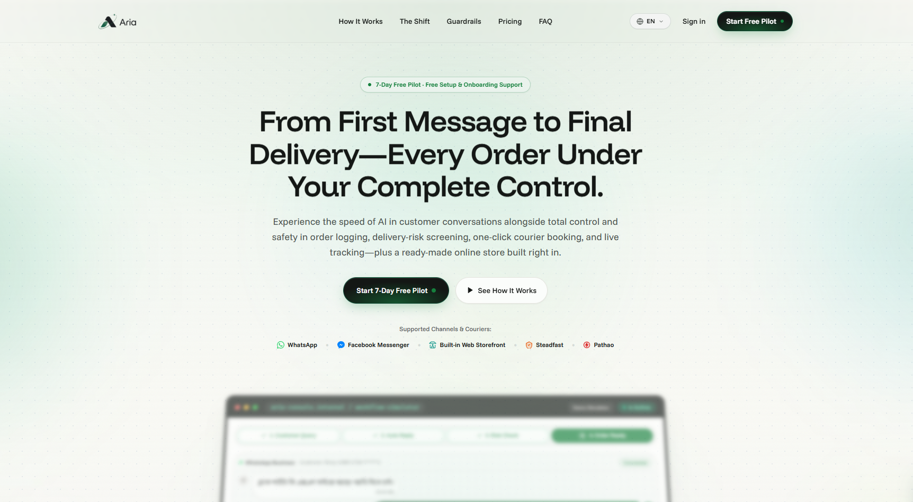
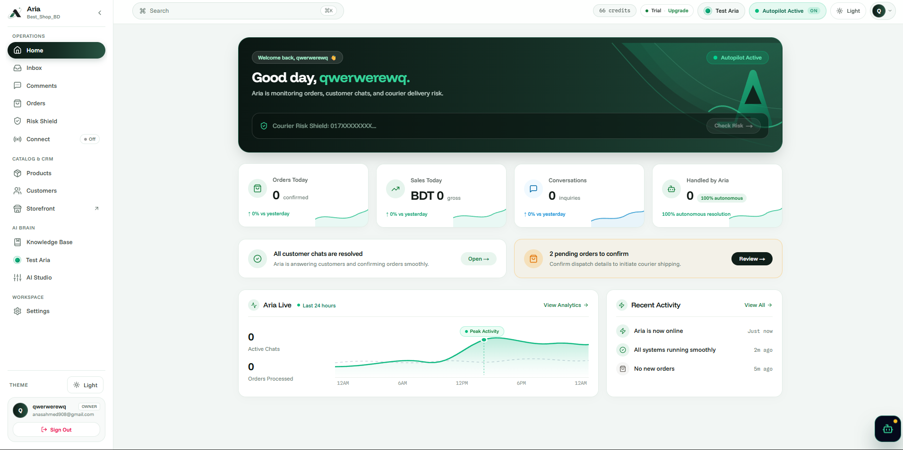
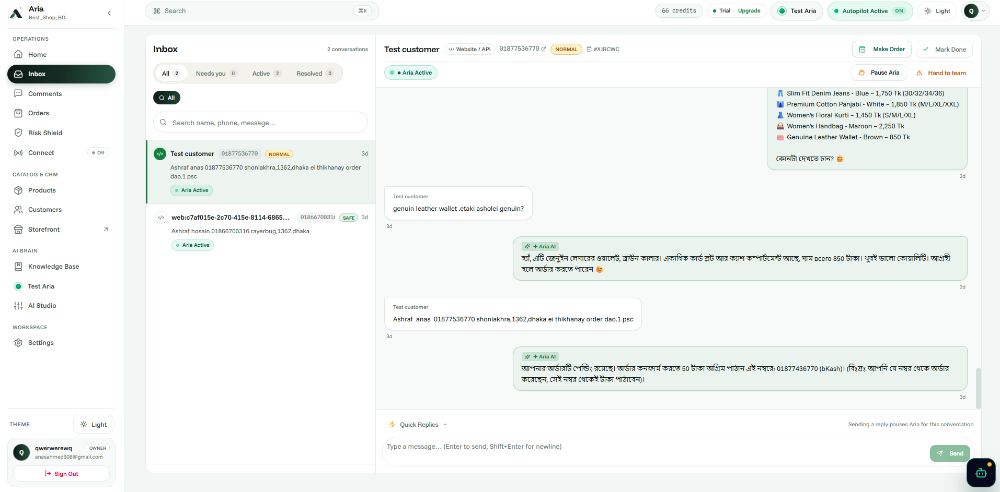

# Aria

**An operations assistant for online shops that turns customer chats into verified, courier-ready orders.**

[Live App](https://aria-autonomous-agent-puce.vercel.app/) · **Status:** Private Repository (Live Showcase)

---

## The Problem

Running an online shop on WhatsApp, Messenger, and Instagram usually breaks down in three places:

1. **Missed sales:** Customers message at midnight asking for prices, sizes, or delivery fees. By morning, they have bought from someone else.
2. **Return fraud:** Cash-on-Delivery (COD) is the default in Bangladesh, and fake or repeat-return orders quietly eat up profit margins.
3. **Unreliable chatbots:** Basic bots guess prices, promise out-of-stock items, or force buyers into rigid button menus nobody wants to click.

Aria was built to handle the messy parts of social commerce end-to-end—without letting an AI guess on prices, stock, or money.

---

## Product Preview

### Storefront & Landing Experience

*Public overview of Aria's chat-to-order workflow, channel integrations, and courier risk screening.*

### Merchant Dashboard (`/home`)

*Live overview of confirmed orders, gross sales, customer inquiries, Autopilot status, and quick access to Ask Aria.*

### Unified Inbox & Order Handoff (`/inbox`)

*WhatsApp, Messenger, Instagram, and web chats in one split-view workspace—with live AI/Human control toggles, risk tags, and one-click order creation.*

---

## What Aria Does

### 1. Chat-to-Order Across Every Channel
- **Unified Inbox:** Brings WhatsApp Cloud API, Facebook Messenger, Instagram DM, and Web Storefront chats into one workspace.
- **Speaks How Buyers Actually Type:** Understands Bangla, Banglish, and English naturally.
- **Handles Photos & Voice Notes:** Buyers can send a product photo to find a matching item, or drop a voice note. Clear voice notes are transcribed and answered; unclear or long ones are handed straight to your team with a playable audio bubble.
- **Smart Message Grouping:** When a customer sends 4 short messages in a row ("hi", "blue shirt ase?", "size L?", "delivery koto?"), Aria waits a few seconds and sends one clear reply instead of spamming 4 robotic ones.

### 2. Live Catalog & Zero Guesswork
- Answers strictly from your live product catalog, stock counts, variants (S/M/L, colors), and store policy docs.
- Collects the customer's name, phone number, address, and items into an order draft.
- The moment all details are in, **backend code takes over**—not the AI. The server creates the order, calculates the delivery fee by area, updates stock, and locks the order so the AI can never accidentally edit or duplicate it.

### 3. Bangladesh Courier Risk Shield
- Automatically screens customer phone numbers against delivery history across **Steadfast and Pathao**, combined with your own shop's past orders.
- **Safe buyers** go straight to Cash on Delivery.
- **New or moderate-risk buyers** automatically receive an advance delivery fee request with your bKash/Nagad/Upay details.
- **High-risk buyers** are flagged and routed straight to your human team before anything is confirmed.

### 4. One-Click Dispatch & Live Tracking
- Push ready orders directly to **Steadfast, Pathao, RedX, CarryBee, eCourier**, or your own manual rider.
- Automatically sends customers a formatted receipt and a live public tracking page (`/track/[token]`) with masked phone details and step-by-step delivery status.

### 5. Built-In Storefront & Full Team Control
- Every shop gets a public storefront (`/shop/[slug]`) with product pages, cart/checkout, downloadable shop-branded receipts, and a live chat widget connected to the same inbox.
- **Human-in-the-loop anytime:** Pause or resume Autopilot globally with one click, jump into any chat, extract an order from a manual chat, or use **Ask Aria** to check daily sales, low stock, and pending orders in plain language.

---

## How an Order Flows

```text
Customer Message (WhatsApp / Messenger / IG / Web)
        │
        ▼
Pre-Check & Media Handling (Phone Regex · Photo Match · Voice-to-Text)
        │
        ▼
Live Catalog & Store Policy Lookup (Vector Search + Stock Check)
        │
        ▼
Order Draft Completed ──▶ AI Stops Here (Backend Code Takes Over)
        │
        ▼
Order Created in DB ──▶ Courier Risk Shield (Steadfast / Pathao / Shop History)
        │
        ├── Safe     ──▶ Ready for COD Dispatch
        ├── Normal   ──▶ Request Advance Delivery Fee
        └── Risky    ──▶ Flagged & Handed Over to Human Team
        │
        ▼
1-Click Courier Dispatch ──▶ Customer Receipt & Live Tracking Link
```

---

## Engineering Notes

Because this repository is public as a showcase while the source code stays private, here are the core technical decisions behind Aria:

- **Code owns the risky parts:** The LLM handles conversation and extraction. Node.js strictly handles stock checks, zone-based delivery fees, order creation, risk labeling, and courier booking.
- **Built for real concurrency:** Per-conversation turn locking prevents rapid customer messages from overwriting order drafts. Atomic database claims prevent double-booking a parcel to a courier if a button is clicked twice.
- **Predictable AI cost:** Prompts are structured in a cache-friendly layout, small catalogs are read directly without extra tool calls, and every reply has hard step and token caps.
- **Multi-tenant isolation:** Every shop's catalog, knowledge base, conversations, orders, and risk lookups are strictly isolated by workspace.
- **Graceful fallbacks:** If a courier API times out, a voice note is unreadable, or a shop runs out of credits, the system never crashes or hallucinates—it routes cleanly to the human inbox.

---

## Tech Stack

| Layer | Stack |
| :--- | :--- |
| **Frontend** | Next.js 15 (App Router), TypeScript, Tailwind CSS, Redux Toolkit (RTK Query), BFF Proxy |
| **Backend** | NestJS 11, Node.js, TypeScript |
| **Database & Search** | PostgreSQL, Prisma ORM, `pgvector` (semantic catalog & policy search) |
| **AI & Media** | LangGraph, OpenRouter (Chat, Vision & Audio Transcription), Supabase Storage |
| **Channels & Auth** | Meta Graph API (WhatsApp Cloud API, Messenger, Instagram), Google OAuth |
| **Couriers** | Steadfast, Pathao, RedX, CarryBee, eCourier |

---

## Live Preview & Inquiries

You can explore the live platform here: **[aria-autonomous-agent-puce.vercel.app](https://aria-autonomous-agent-puce.vercel.app/)**

The source code for Aria is closed-source. If you want a walkthrough of the architecture, want to pilot Aria for your store, or are interested in licensing, feel free to reach out:

- **Email:** [anasahmed4484@gmail.com](mailto:anasahmed4484@gmail.com)
- **Portfolio:** [ashraf-uddin-ahmed.vercel.app](https://ashraf-uddin-ahmed.vercel.app)
